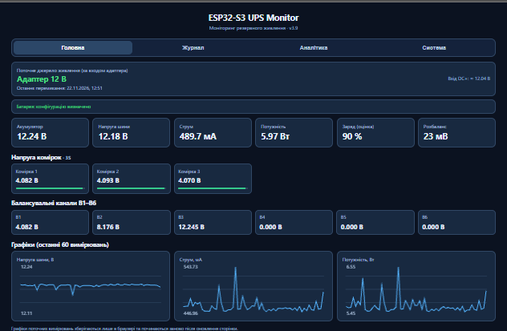
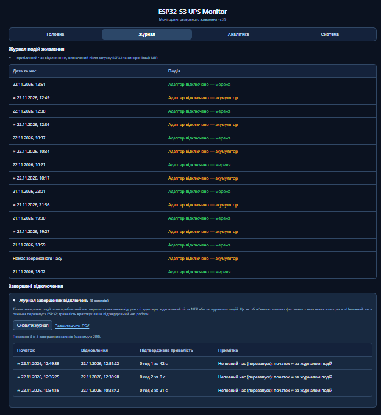
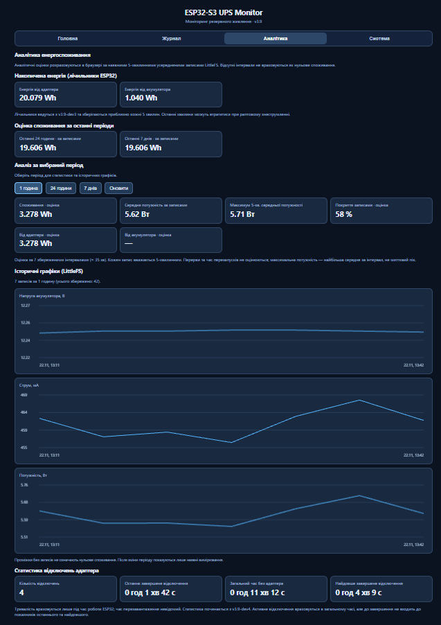
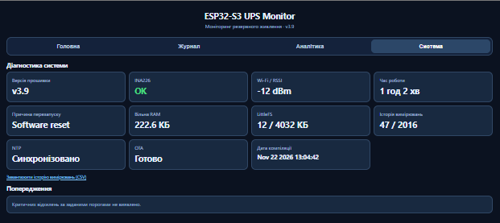

# ESP32-S3 Smart UPS Monitor

**Stable firmware: v3.9 (22 November 2026)** · [Українська версія](README.md)

Experimental battery-backup monitoring for a Wi-Fi router and optical network unit (ONU), using ESP32-S3, INA226, a YX850 relay switch, and LM2596 DC-DC converters.

### Live dashboard preview

## Features

- Four-tab local web dashboard: Home / Events / Analytics / System (UI text is Ukrainian).
- Live electrical measurements, Li-ion cell-voltage monitoring through voltage dividers, 1-hour/24-hour/7-day history charts, energy counters, and saved outage events.
- Telegram bot: `/start`, `/status`, `/battery`, `/schedule`, `/help`, plus adapter loss/return alerts and a stored notification queue.
- A schedule feed currently targets **Poltava region, queue 1.2**, via a third-party unofficial source; it must be adapted for other regions. Automated 60/15-minute reminders are implemented but have not been separately validated in real time.

## Requirements and installation

- VS Code + PlatformIO; hardware matches the ESP32-S3 N16R8 configuration in `platformio.ini` (16 MB Flash, 8 MB OPI PSRAM).
- Copy `include/secrets.example.h` to the ignored `include/secrets.h`; enter your own Wi-Fi, OTA, Telegram token and chat ID values.
- The default `COM3` and `192.168.0.103` in `platformio.ini` refer to one author's test setup. Use your own ports and device IP.
- Build using `pio run -e esp32s3`. For initial USB flashing change `upload_protocol` to `esptool`; use `espota` with your own IP and `ota_password.txt` later.
- Full instructions: [Getting started](docs/GETTING_STARTED.md) · [Hardware](docs/HARDWARE.md).

## Safety warning

**NOT a certified UPS or a Li-ion battery protection system.** The experimental design has no BMS, no automatic charging, and no hardware low-voltage disconnect. Software monitoring is NOT a substitute for battery protection. Relay switching can reboot all loads, and LM2596 cannot raise a low 3S voltage to 12 V. Read [SAFETY](docs/SAFETY.md) before any hardware work.

## Project documentation and license

[Changelog](CHANGELOG.md) · [History](HISTORY.md) · [Release v3.9 notes](RELEASE_NOTES_v3.9.md) · [Contributing](CONTRIBUTING.md) · [Security](SECURITY.md) · [MIT License](LICENSE).
## Web interface screenshots (v3.9)

Actual captures from the ESP32-S3 Smart UPS Monitor v3.9 web UI on 22 November 2026. Displayed readings are examples from one test unit, not specifications for other hardware.

### Home — live electrical readings

### Events — power transitions and outage history

### Analytics — persistent LittleFS measurements

### System — diagnostics

